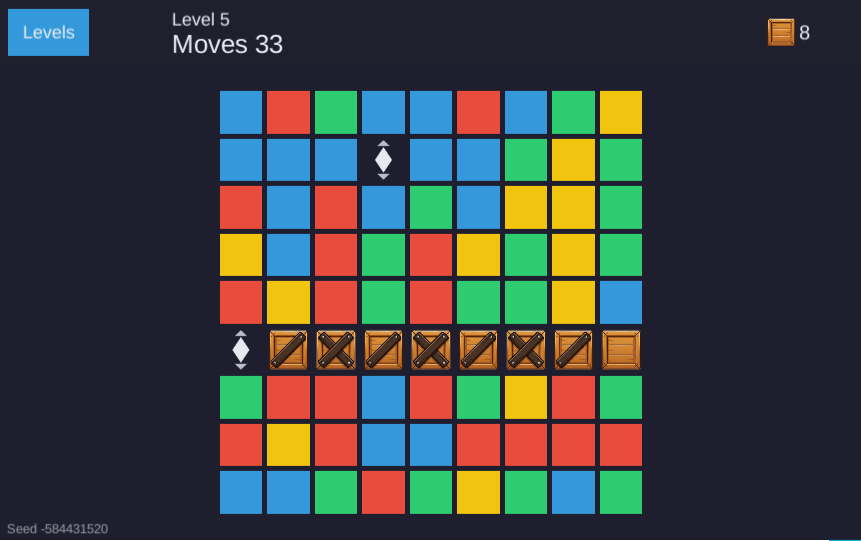

# BlastGame

[](https://github.com/burcakemalsen/BlastGame/actions/workflows/tests.yml)

A mobile "blast" (collapse / match-2) puzzle game prototype built with Unity 6000.6.3f1 and C#. The name is a placeholder.

**▶ Play in the browser: https://burcakemalsen.github.io/BlastGame/**
(WebGL build from the `gh-pages` branch; desktop and mobile browsers with WebGL 2, e.g. Chrome or iOS 16.4+ Safari.)

**How to play:** tap or click a group of two or more same-colored tiles to pop it, and reach the goals shown at the top before you run out of moves.



## What you can play now

- **Levels:** 7 levels loaded from JSON files, each with a move limit and goals (colors and obstacles), win and lose screens, and a level select.
- **Special items:** big groups create a rocket (clears a row or column), a bomb (3x3) or an orb (clears one color); touching specials merge into six combos.
- **Four original obstacles:** pinata, crate with 1 to 3 layers, water balloon over a tile, and an anchor that must be brought down to the bottom row.
- **Blast feel:** groups pop inside out, goal items fly to their goal icons, new tiles pour in from the top.
- **Tests:** 1,226 automated tests on the rules layer, run by CI on every push.

**Status:** steps 1 to 7 (core gameplay, special items, combos, obstacles, blast feel) are done; new levels with a difficulty curve are being added now. Progress per step is in [docs/PLAN.md](docs/PLAN.md#5-adımlar).

## Built with AI assistance

This game is developed with AI agents, openly. The human (product owner) sets scope, approves every spec, plays each build and makes the final calls. AI agents write the code, each in a separate role:

- **Orchestrator** writes specs and task briefs, starts the other agents, reviews their reports and diffs. It does not write game code.
- **Coder** writes the stubs and then the implementation.
- **Tester** writes tests from the spec and stub signatures only, trying to break the code.
- **Two independent reviewers** (from different model families) hunt for defects and weak tests.

The obstacle art was generated with an AI image model and approved by the product owner.

Every step passes a gate: spec → stub → tests (must be red) → code (tests green) → independent review → human play-test. Each step lives on its own branch with one commit per stage (so the red-test commit precedes the green-code commit), then a pull request that merges only when CI is green, as a merge commit. See [docs/PLAN.md](docs/PLAN.md#9-git-akışı) for the git flow. The rules every agent follows are in [docs/RULES.md](docs/RULES.md); the architecture, roles and steps are in [docs/PLAN.md](docs/PLAN.md).

## Architecture

- `Assets/Scripts/Core/`: pure C# game rules, no `UnityEngine`, randomness only from an injected seeded source.
- `Assets/Scripts/View/`: Unity rendering, animation and input; asks Core, makes no rules of its own.
- `tests/`: xUnit tests that compile the Core sources in place (no copies) and run in seconds with `dotnet test`.

## Running

Requires Unity 6000.6.3f1 (with Android Build Support and WebGL Build Support), the .NET SDK and PowerShell. Close the Unity Editor before running the Unity scripts.

```powershell
dotnet test tests/BlastGame.Tests.slnx                                    # rule-layer tests
powershell -ExecutionPolicy Bypass -File scripts/unity-check.ps1          # compile check, no Editor window
powershell -ExecutionPolicy Bypass -File scripts/build-android.ps1        # builds Builds/Android/BlastGame.apk
powershell -ExecutionPolicy Bypass -File scripts/build-webgl.ps1          # builds Builds/WebGL (index.html + Build/)
powershell -ExecutionPolicy Bypass -File scripts/deploy-webgl.ps1         # commits that build to the local gh-pages branch (no push)
powershell -ExecutionPolicy Bypass -File scripts/prepush-scan.ps1         # pre-push scan of staged changes
```

To play in the Editor, open the project folder in Unity Hub.
